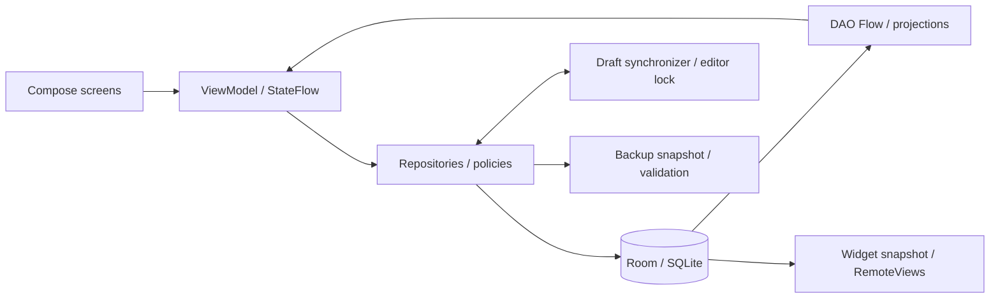

Текущие настройки/городские профили0.28 —[57](57_SETTINGS_CITIES_280.md). Room25/ZIP23, ShopEntity.cityGroupKey связывает независимые профили адресов одного магазина. Пользовательская смена города —ShoppingListRepository.changeShoppingCity; прежние read/select для restore сохраняют снимок.

Аудит0.27 —[56](56_INDEPENDENT_AUDIT_270.md). Исторические Room24/ZIP22: избранные магазины, общий EditorSheet, согласованные контексты списков/виджета и свежая навигация после полного восстановления. Ссылки с версиями ниже описывают происхождение контрактов; результаты текущей проверки/публикации —01/57.

Виджет0.26 —[55](55_WIDGET_SETTINGS_260.md). Room23 прежний, полныйZIP21. WidgetAppearance использует общие формулы цветов; WidgetSettings задаёт независимые фоны и купленное; provider пишет только флаг показа, factory фильтрует до заголовков. Настройки общие для всех экземпляров.

Текущие списки0.25 —[54](54_UNIFIED_LISTS_250.md), Room23/ZIP20. Единый владелец строк GoalListEntity, общий AddToListScreen с targetListId и PurchaseQuantityStepper; ListCopySheet доступен всем спискам. Старое разделение шаблонов отменено.

Дополнение мест0.24.2 —53. Room22/ZIP19: Venue.kind, транзакционный VenueRelocation, CityPicker и ShopSymbolPicker. Сеть и торговое место независимы. Контракт52 сохраняется; прежнее разделение51 отменено54.

Актуальное дополнение0.24.1 —[52](52_QUICK_ADD_APPEARANCE_241.md). AddToList использует общий выбор единиц и отложенный поиск без вставки индикатора. ShopAppearance открывает локальный редактор по палитре; NetworkDepartments согласует отделы профилей одной сети. Главная/магазин/виджет используют общий displayOrder отделов, прежние порядки точек сохраняются только для обмена.

Актуальный контракт мест0.23 —[50](50_VENUES_SHARED_ADDRESS_230.md): Room20/ZIP17, общий адрес Venue и label точки.

# Атлас архитектуры ·0.28.0

Настройки0.21 описаны в48; предыдущие дополнения0.22 —[49](49_STORE_POINTS_UNITS_220.md), Room19/ZIP16. Шесть стилей и три режима сброса сохраняются.

Текущее хранилище: Room24, 20 таблиц; полный резервный ZIP22. Главная/единые списки —54/56, виджет —55/56. Результаты текущей проверки и публикации —01/56; порядок сопровождения —42. Исторический атлас до этого аудита сохранён в history/41_ARCHITECTURE_ATLAS_before201.md.

Это действующая карта приложения. Причины отдельных исторических исправлений — в24–40; фактические поля и ограничения — в Entity/DAO/миграциях. Пути ниже относительно корня репозитория; код Kotlin находится под `app/src/main/java/com/spisokryadom/app/`.

## Слои и источник истины

`SpisokRyadomApp` создаёт `AppContainer`. Container связывает одну `AppDatabase`, LocationRepository, репозитории, синхронизатор черновиков и BackupManager. Compose отображает состояние и отправляет команды; бизнес-назначения и атомарные изменения живут в репозиториях. Room — источник фактов. SharedPreferences хранят настройки и сырые состояния редакторов, но не заменяют таблицы покупок.

## Карта кода

| Область | Главные файлы | Ответственность |
| --- | --- | --- |
| Запуск / зависимости | `SpisokRyadomApp.kt`, `AppContainer.kt` | Контейнер, восстановление разрешённых черновиков, наблюдение за данными |
| Навигация | `navigation/NavGraph.kt`, `Routes.kt` | Четыре вкладки, параметры карточек и раскрытие результата |
| Хранилище | `data/db/AppDatabase.kt`, `data/entity/`, `data/dao/` | Room24, FK/индексы, запросы и миграции |
| Регулярные покупки | `data/repository/ShoppingListRepository.kt`, `ui/shoppinglist/` | Количество/отметки, назначение места, проекция общего экрана |
| Каталог | `ProductRepository.kt`, `ui/productdb/` | Постоянные товары, поиск, избранное, создание из запроса |
| Карточка товара | `ui/productcard/` | Raw-форма, ручной/автоматический Save, согласование внешних правок |
| Добавление | `ui/addtolist/`, `AddProductCandidates.kt` | Выбор до ввода, фильтр магазина, поиск, новый товар |
| Места покупки | `ShopRepository.kt`, `domain/PurchaseAssignment.kt`, `PlaceLabels.kt` | Доступность и приоритеты, общие подписи адреса/рынка/павильона |
| Целевые планы | `GoalListRepository.kt`, `ui/goallists/` | Владение строками, быстрые позиции, каталог, цена плана, обмен |
| Массовые операции | `BatchRepository.kt`, `ui/batch/` | Команды для набора уникальных ID, проверка набора до записи |
| Справочники / правила | `ClassifierRepository.kt`, `StandardCategories.kt`, `CreationPresetDao.kt` | Категории, единицы, получатели и FK-преднастройки |
| Общие настройки | `ui/settings/`, `util/ProductCreationDefaults.kt`, `ProductEditingPreferences.kt` | Preferences, управление справочниками, правила нового товара |
| Сброс | `data/repository/ResetRepository.kt`, `ui/settings/SettingsCards.kt` | Три подтверждаемых режима, editor/media lock, транзакция, согласование черновиков и поколение |
| Резервная копия | `data/backup/BackupManager.kt`, `BackupJson.kt` | Полный ZIP22, фотографии, валидация и атомарное восстановление |
| Текст для отправки | `ui/bulk/ShoppingTextViewModel.kt`, `BulkScreen.kt` | Временный текст из снимка покупок, без записи обратно в корзину |
| Виджет | `widget/`, `ui/settings/WidgetSettingsCard.kt` | Общая база, группировка/шрифт/фоны, фильтр купленного, отметки и открытие приложения |
| Общие визуальные правила | `ui/components/EditorSheet.kt`, `Appearance.kt`, `Favorites.kt`, `ShoppingSymbols.kt`, `ShoppingBlockColor.kt` | Компактные редакторы, 79 значков, цвета, избранное и подложки |
| Общие границы | `CatalogueEdits.kt`, `MediaLifecycle.kt`, `util/Quantities.kt`, `PurchaseMoney.kt` | Синхронизация редакторов, медиа, единицы и денежные вычисления |

## Четыре разных понятия

**Товар** (`ProductEntity`) — описание в каталоге, избранное, товарная группа, получатель, обычные количество/единица и тип покупки. **Покупка** (`ShoppingListEntryEntity`) — конкретная строка с количеством, отметками и текущим местом. **Товарная группа** — глобальная классификация товара. **Тип отдела** — общий словарь, из которого создаются размещения отделов у конкретного магазина. Из наличия типа «Молочка» не следует, что он размещён у каждой аптеки.

Временный товар (`isTemporary`) поддерживает быструю покупку без засорения постоянного каталога; удалять его можно только после проверки использования. Магазин/профиль и его физическая точка тоже различаются: сеть и рынок/ТЦ — контекст группировки, адрес или павильон — место покупки. Не формировать подписи вручную из случайных полей; использовать общий PlaceLabels, чтобы не дублировать название павильона как адрес.

## Покупки и целевые списки

`listId == null` означает регулярную покупку; непустой `listId` — принадлежность одному GoalListEntity. Флаг `showInPurchases` разрешает показ той же строки на общем экране. Количество, отметка покупки, перенос и удаление действуют на один ID. Копирование строки для общего показа создаст расхождения, поэтому запрещено.

Целевой план допускает временный товар, пустую единицу и текстовое место без каталога магазина. `plannedUnitPrice` относится к конкретной покупке плана и не переписывает цену товара каталога. Быстрые целевые позиции сохраняют эту свободу; defaults новых карточек не меняют уже заведённую единицу ценового плана.

## Единые списки0.25

Все GoalListEntity теперь одного вида: миграция22→23 снимает isTemplate без удаления списков и строк. Колонка и читатели старого переносимогоv3/полногоZIP≤19 сохраняются для совместимости; новые записи false, ZIP20 требует false. Подробности54. Главная по-прежнему показывает те же строки видимых списков. Отдельная команда copyList создаёт независимые покупки в транзакции, не меняет источник, проверяет поколение/версии и запрещает самокопирование. Временные товары клонируются, постоянные остаются ссылками.

ListCopyViewModel позволяет отправить любой список на Главную, в новый либо существующий список; перед копированием показано назначение и предупреждение. captureList сохраняет текущие покупки отдельным обычным списком. Старый отдельный UI подбора в GoalListViewModel удалён.

AddToListViewModel использует один экран с Главной. Для Главной статус берётся из pending-агрегата; для списка —из его собственных строк, включая купленные. Оба повторения избранного показывают реальное количество; живая панель показывает текущий состав, включая временные позиции. ProductCard возвращает выбранный товар через SavedStateHandle, а явное добавление записывает в прежний listId. Нажатие строки открывает настоящую карточку, меню строки —количество/цену/заметки покупки. PurchaseQuantityStepper общий с Главной. Активный favorites_only по-прежнему показан явной плашкой.

## Карточка и внешние изменения

`ProductCardViewModel` держит свободные текстовые поля; `ProductEditDraft` сериализует raw-форму и записывает проверенный товар через репозиторий. `ProductEditorTransactions` сериализует согласованные команды и содержит generation: редактор, открытый до полного восстановления базы, не должен записывать данные поверх новой базы.

`ProductDraftSynchronizer`, `ActiveProductDraft` и `withCatalogueEdits` согласуют массовые команды, перенос и редактирование открытой карточки. Сохранять целый старый объект поверх свежих данных опасно: редактируемые поля и текущие факты должны объединяться. Для позиций планов маска GoalItemField также ограничивает изменения реально отредактированными полями.

Автосохранение карточек включено по умолчанию, но отключается. Ручной режим записывает каталог только по Save; его временная raw-тень не восстанавливается при следующем запуске. Очистка имени нового собственного автотовара без покупок отзывает его строку. У существующего/использованного товара пустое имя требует исправления и не удаляет покупки.

## Назначение места и перенос

Базовые варианты — подобрать автоматически, явно без магазина, выбранный магазин/точка. `explicitNoShop` и `awaitingShopCityId` различают пользовательский отказ и ещё не разрешённое назначение. Доступность, порядок магазинов и точек вычисляются общей политикой; карточка, массовые операции и добавление должны использовать её одинаково.

Перенос может сначала добавить отсутствующий магазин к товару. Настройка запоминания приоритета управляет будущим предпочтением; перенос текущей строки и изменение приоритетов не следует смешивать без этой настройки. Исторические купленные строки не нужно переписывать ради нового предпочтения каталога.

## Преднастройки 0.21

`ProductCreationDefaults` читает общий тип (первоначально offline) и fallback единицы (первоначально шт) из shopping_list_prefs. Новый редактор оставляет поля количества/единицы пустыми. При сохранении новой карточки они подставляются только с включённым new_product_fill_missing; на новой установке выключено, ранее заданная единица/количество сохраняет совместимое включённое поведение до явного отключения. Фактическая покупка без ввода количества получает1, nullable-поля карточки остаются независимы.

`ShopCreationPreset`: inherit / offline / online / both. Правило основного магазина нового товара определяет доступные типы; при inherit/both действует общий default с возможностью ручного выбора. `GroupCreationPreset`: получатель по умолчанию для новой карточки. Явный получатель, включая «не задано», имеет приоритет. При записи правила читаются заново, чтобы мгновенный выбор группы и Save не обходили преднастройку. Существующие товары не переписываются просто от изменения настройки.

Обе таблицы связаны FK: удаление магазина/группы удаляет правило, удаление получателя снимает его ссылку. Хранить ID правил строками в preferences вместо FK не нужно. Правила экспортируются ZIP15. Сырые черновики помнят, был ли recipient/type выбран вручную; старые raw-форматы читаются с совместимыми значениями.

## Два вида обмена и текст сообщения

1. **Полная копия**: BackupManager, ZIP22. Весь снимок базы, настройки и доступные медиа; восстановление заменяет текущую базу. До записи проверяются версии, типы, ID, ссылки и содержимое архива. Файлы и SQLite не должны остаться в половинном состоянии при отказе.
2. **Отдельный целевой план**: GoalListTransfer, текст/JSON. Независимые переносимые DTO, без доверия локальным ID отправителя, с предпросмотром импорта. Это не команда заменить всю базу. Разные версии формата сохраняют различие заметки и отдельного комментария.
3. **Обычный текстовый список**: временное редактируемое сообщение для чтения/отправки. Закрытие перечитывает данные; текст не парсится обратно в корзину. Импорт целевого списка не возвращает прежнюю отменённую функцию text→basket.

## Библиотека и виджет

StandardCategories устанавливает30 групп и30 типов отделов при создании/миграции16. Пользовательские операции вынесены в подтверждаемые режимы ResetRepository: восстановить готовые группы, только исходные справочники или сбросить всё. Универсальной кнопки «добавить списки» нет. Библиотека не создаёт размещения во всех магазинах; полное восстановление сохраняет точный снимок. Полные классификаторы алфавитны; favoriteOrder относится только к верхней избранной проекции, маршруты ShopDepartment.displayOrder независимы.

Виджет использует тот же снимок покупок. WidgetSettings задаёт группировку, отделы, шрифт и независимые фоны/фильтр купленного. Чекбокс сохраняет CAS по конкретной покупке; глаз отправляет целевое состояние без изменения БД. RemoteViews при каждом bind сбрасывает цвет, звезду и начертание, применяя общую политику избранного. Плюс через PendingIntent всегда открывает добавление на Главную, не продолжает подбор другого listId. Проверка на OEM-лаунчере требует телефона.

## Актуальные редакторы и избранное

Карточка магазина: ShopCardBlocks/ShopAppearance/ShopSymbol/ColorField, сводка места с явным редактированием, EditorSheet выбора/оформления, значок либо logoUri, прокручиваемый предпросмотр. Палитра находится справа в строке «Избранное», как в товаре. ShopEntity содержит iconKey/logoUri/shoppingBackground/purchaseBackground/isFavorite/favoriteOrder; жизненный цикл медиа —PhotoStore/MediaLifecycle. Правила —53/56;44 описывает исходную итерацию.

Карточка товара: ProductShopDialog объединяет группу магазина, все/выбранные точки и порядок точек. configureShop применяет один согласованный raw-edit; ProductEditDraft→ProductRepository сохраняет его транзакционно. Подтверждённая общая группа снимает старые исключения только этого магазина. Фото —BranchPhotoEditor.compact с подтверждением удаления. Правила —45.

Группы имеют две проекции одних ID: полный alphabetical и верхний favoriteOrder. Переставляются только избранные; маршруты магазинов/отделов независимы. FavoriteAppearanceProvider/LocalFavoriteSurface/FavoriteBlock выбирают одну из шести независимых политик: покупки, обычные списки или dropdown × block/row. При добавлении избранного nextFavoriteOrder безопасно уплотняет предельные импортированные порядки. Повторная установка уже установленного флага не пишет данные. Правила —46/48.

## Единый UI-каркас и избранные магазины0.27

EditorSheet закрепляет заголовок/действия и прокручивает тело над клавиатурой; busy блокирует Назад и скрытие жестом. На нём основаны компактные настройки, ввод имени, выбор справочников, ProductShopDialog, оформление магазина/символа, перенос и массовые действия. Подтверждения/ошибки/справка используют AlertDialog; длинные PlaceEditorDialog с адресами и медиа остаются полноэкранными с верхним Save. Живые preferences закрываются «Готово», локальные черновики —явным применением/отменой.

Shop favorites —две UI-проекции одних ID. Верхняя сортируется favoriteOrder, полная сохраняет маршрут displayOrder и место/рынок. Порядок избранного не переназначает покупки. Стили берутся из общей FavoriteAppearance для соответствующего контекста; выбор магазинов использует DROPDOWNS, обычный перечень —LISTS. Room23→24 добавляет neutral-default поля, ZIP22 переносит/валидирует их, прежние копии читаются.

GoalPurchaseRow содержит реальные магазин/точку/место/отдел; группировка и цвета используют общие подписи и helpers. Видимость showInPurchases и владение listId прежние; оформление не создаёт копий. Общий QuantityUnitInputWithSuggestions сохраняет свободный ввод и показывает прочие единицы после релевантных.

## Граница восстановления и удалённые механизмы

Полное восстановление увеличивает ProductEditorTransactions.generation под общим reentrant coroutine lock. Долгоживущие редакторы фиксируют поколение при создании; окно добавления покупки и карточка магазина теперь тоже выполняют команды через inGeneration. Старый экран после импорта не может записывать в восстановленную базу по повторно использованному ID. После успешного полного импорта Settings сообщает результат и пересоздаёт навигацию с Главной; прежние ViewModel всех вкладок освобождаются. Изолированное восстановление BackupManager по-прежнему защищено поколением и без UI.

У regular text-share нет команд записи в покупки. Удалены старые addBatch/replacePendingText/undoBatch/PurchaseRequest, тестовый BulkViewModel и ShoppingTextParser; действующие BulkScreen/ShoppingTextViewModel/renderShoppingText оставлены. Импорт целевого списка использует отдельный GoalListTransfer и остаётся полноценной функцией.

Массовая группа товара задаётся всему магазину через ProductBatchChange.Department(shopId,typeId). Старого параметра branchId и его raw-reconciliation ветвей больше нет. Старые сохранённые per-point группы читаются, экспортируются, мигрируют и участвуют в совместимом назначении, пока пользователь явно не подтвердит общую группу магазина. Таблицы/миграции для чтения прежних данных не являются мёртвым кодом.

В рамках аудита удалены неиспользуемые старые UI, demo seeder, дублирующие команды записи и устаревшие ресурсы. Исполняемые миграции, DAO для восстановления/проверки, инспекционные API и Android/Room entry points не удалять только из-за отсутствия текстового вызова. Подробности —47 и docs/releases/0.20.1/removed-code.json.

## Карточки0.22

49 описывает purchaseBackground магазина, SelectionDialog, UnitChoices и единые подписи ТЦ. Сеть и контейнер каждой точки независимы; смешанный профиль имеет один ID, несколько представлений. Room19/ZIP16.
